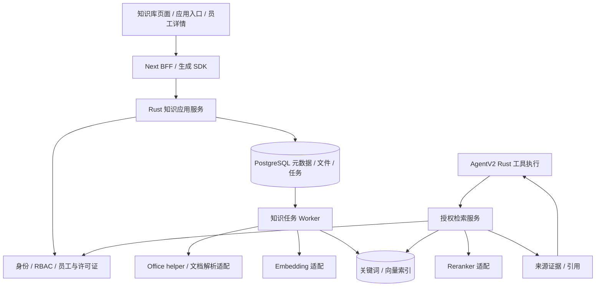

> 2026-11-06 三类知识库管理增量：应用基础设置、全局设置与运营中心员工知识入口已编码，含原件/版本管理及员工更新同步合同。仅编译和静态检查，真实数据库/安装链路待手测；解析、索引和 RAG 尚未接入。详见[本批实现记录](agent-v2-knowledge-management-report.md)。

# AgentV2 知识库与 RAG 架构设计

日期：2026-11-06。状态：目标架构与实施规格；K1管理、K2解析、K3关键词与精确向量/RRF/重排及K4工具与引用已编码；pgvector/HNSW和真实链路验收尚未完成，详见文末实施登记。

本文依据已确认的三类知识库业务规则制定。运行核心沿用独立 Rust、Rig、现有用户 RBAC、员工能力及客户独立部署模式；不恢复 DSH，不引入商业多租户系统。数据库现有 `tenant_id` 仅作为部署隔离兼容字段。

配套：[现阶段计划](agent-v2-current-stage-plan.md)、[主架构](agent-v2-architecture.md)、[开发计划](agent-v2-development-plan.md)、[验收矩阵](agent-v2-acceptance.md)。知识库专项发生冲突时，以用户最新决定及本文明确的新规则为准，不能用历史建议恢复员工应用范围授权、运行预算或强制 Docker。

## 1. 目标与范围

交付业务链路：

**管理知识库 → 上传或同步文档 → 持久解析和索引 → 按当前权限检索 → Agent 阅读证据 → 回答引用 → 查看来源。**

知识服务是平台公共应用模块，AgentV2 是首个调用方。文档、授权、版本和索引不绑定聊天会话，后续其他 AI 功能可调用同一服务。复用现有数据库、身份服务、员工安装服务、模型供应商服务及 Office helper；不因抽象复用而要求先拆出独立微服务。

### 1.1 三类知识库

| 类型 | 业务归属 | 内容维护 | 使用与访问 |
| --- | --- | --- | --- |
| 应用知识库 `application` | 当前部署中的一个应用 | 有管理权限的客户平台用户 | 当前所有有效平台用户可读，管理仍受权限约束 |
| 全局知识库 `global` | 当前客户平台 | 有管理权限的客户平台用户 | 当前所有有效平台用户可读，管理仍受权限约束 |
| 员工自带知识库 `employee_bundle` | 已安装 AI 员工及包版本 | 运营中心编辑、发布；客户端原件只读 | 资料读取检查安装、许可证和包版本；Agent还固定当前员工及任务范围 |

应用知识库和全局知识库可存在多个，例如“采购规范”“产品手册”“公司制度”。员工自带知识库由员工包声明的稳定集合标识区分。三类共用检索与索引实现，不建设三套后端。

第一版不新增个人知识库。员工自带知识不包含客户上传资料；客户扩展资料放在应用或全局知识库，员工更新不得覆盖。

### 1.2 与现有资源的边界

| 资源 | 当前用途 | 与知识库的关系 |
| --- | --- | --- |
| 会话附件及工作区 | 当前对话输入、生成产物 | 不自动索引；用户显式“加入知识库”才复制到独立文档版本 |
| 平台应用记录 | 实时业务事实 | 继续走平台查询工具与行、字段权限；不默认全库向量化 |
| Skill 指令 | 执行方法和工具使用指导 | 保留现有执行链，不当作普通知识覆盖系统规则 |
| 员工知识资料 | 专业手册、规则说明、示例 | 作为不可信参考资料检索，不能授予工具权限 |
| 会话历史与内部摘要 | 对话恢复和模型输入管理 | 不自动变成跨会话知识或长期记忆 |

首批覆盖 PDF 文字、DOCX、XLSX/ODS/CSV/TSV、Markdown/TXT 的完整有界解析。XLS 沿用已有能力但须提供真实样本验收后开放；PPTX 可在相同解析合同下后续接入。扫描 PDF 返回需要 OCR 的明确状态，不把空文本记为索引成功。

OCR、网页抓取、实时业务索引、GraphRAG、跨会话长期记忆、自动知识整理和独立向量数据库不属于第一批交付。

## 2. 关键架构决策

| 事项 | 决策 | 原因与验证边界 |
| --- | --- | --- |
| 服务位置 | 平台 Rust 公共模块，Worker 处理后台知识任务 | 复用授权和持久恢复，避免新增必需服务 |
| 元数据和原件 | PostgreSQL 独立知识表 | 首版降低部署复杂度，不复用会话文件生命周期 |
| 向量检索 | 优先 PostgreSQL + pgvector | 实施前验证 Windows/Linux 安装及发布；目前不宣称已部署 |
| 关键词检索 | 必须支持中文与料号的实际索引检索 | PostgreSQL 默认英文配置或 `LIKE` 不能冒充完整中文检索 |
| 排名融合 | 关键词和向量分别排名，RRF 合并 | 避免直接相加不同量纲的分数 |
| 重排 | 定义独立 Reranker 适配并在首版检索批次接入 | 实际启用依赖可用配置；未启用时明确为基础混合检索模式 |
| 模型调用 | 复用模型供应商管理、加密凭据和 Rig 适配 | 聊天、Embedding、Reranker 是不同用途，不假定供应商全部支持 |
| Cordis | 可作为后续解析/来源适配扩展点 | 核心索引与授权不依赖插件，不向 Host 下发数据库或模型密钥 |
| 状态一致性 | 版本原子激活、任务幂等、执行权 epoch | 未完成索引不替换当前可用版本 |

Rig 负责其支持的 Embedding/模型协议；无法直接支持的重排协议通过明确的 Rust 适配器处理，不宣称 Rig 自动提供完整 RAG 治理。模型上下文窗口沿用当前平台配置，不新增累计任务预算或用户“增加预算”交互。

### 2.1 部署前技术验证

在正式索引迁移前固定以下决策，并将版本、许可与实际命令记录到实施报告：

1. 目标 PostgreSQL 版本、pgvector 版本、Windows 开发与 Linux 发布安装方式。扩展安装由部署维护步骤负责，应用启动不得自动提权。
2. 中文关键词后端：验证可部署的中文分词/全文扩展；若采用 Rust 预分词加 PostgreSQL 索引，明确实际排名算法与中文词典版本，不把 `ts_rank` 称为 BM25。如需 Tantivy 等外部持久索引，另写一致性与运维决策后再引入。
3. 用中文制度文档、料号、混合中英文、表格样本比较候选解析器和检索质量。未通过时不以加大 top-k 掩盖问题。
4. 对暂不支持 pgvector 的环境提供明确诊断。若允许关键词模式运行，页面及查询结果必须标明，不标记混合检索验收完成。

## 3. 模块与依赖

职责建议：API 的公共知识模块负责业务授权、文档管理、检索及来源访问；独立 Rust 核心模块负责合同、规范化及索引任务状态；Worker 负责领取任务和调用解析/模型适配。具体目录在实施批次中按现有结构落地，不先批量建立空 crate。

后台索引不占用聊天会话 FIFO。并发上限、解析资源限制、单次网络超时独立配置，避免大文档阻塞会话执行。

## 4. 归属、权限与检索范围

### 4.1 当前规则（2026-11-09修订）

客户平台统一配置Embedding和可选Reranker，三类知识共享向量，不使用运营端模型连接。当前所有有效登录平台用户均可读取知识，不叠加知识库或应用的读取RBAC。管理知识文档和模型配置仍使用原管理权限，业务数据工具的RBAC不受影响。

部署隔离、员工知识安装/许可证/包版本、来源完整性与任务范围继续检查。共享资料不等于共享私人会话：会话、附件、调用和引用仍绑定用户及run。Agent读取员工包知识仍固定当前执行员工；员工使用权和工具能力保留原规则。

### 4.2 默认范围

| 入口 | 默认范围 |
| --- | --- |
| 独立 `/agent-v2` | 当前部署全局知识 + 当前员工自带知识；用户可选择应用知识库 |
| 知识库管理页试搜 | 当前知识库，不要求知识读取grant |
| 设计器内嵌Agent | 当前未接入；不能宣称自动添加当前应用已完成 |

范围按消息冻结，模型只能缩小不能扩大；新文档和能力不自动加入旧任务。新任务使用ruleVersion=2，历史任务不自动扩权或改用新模型。应用归属用于业务组织，而非当前知识读取权限限制。

### 4.3 服务端复核

每次检索、向外部重排供应商发送片段、打开引用和下载，都检查有效登录、部署、来源存在、版本及员工包状态。员工知识失效或来源删除不能通过向量缓存继续披露。所有片段属于不可信参考数据，不能成为系统指令或业务授权依据。

平台检索连接独立保存密文，配置管理员账号并非运行身份。任务冻结平台profile ID，配置切换需新任务；个人聊天路由保持独立。详见[平台统一检索报告](agent-v2-knowledge-platform-report.md)。

## 5. 数据模型

以下为逻辑表合同，物理命名建议统一 `knowledge_` 前缀。采用平台增量迁移，不修改历史迁移。执行前再核对现有实体；本文不直接新增表。

| 实体 | 核心字段与约束 |
| --- | --- |
| `knowledge_bases` | id、部署、kind、名称、application_id 或 employee_id、稳定包集合 ID、创建人、状态、policy_version；按 kind 检查归属字段，禁止同时归属多个类型 |
| 知识管理权限 | 管理沿用现有RBAC；现阶段知识读取不要求资源授权，不新建读取ACL |
| `knowledge_documents` | 所属库、稳定文档 ID、显示名、来源类型、current_version_id、删除标记；员工文档另有包内稳定键 |
| `knowledge_document_versions` | 文档版本号、原件 hash、原件 blob、实际格式/大小、来源包版本、创建人、解析限制与状态；原件不可变 |
| `knowledge_index_generations` | 文档版本、parser/chunker 及词典版本、Embedding 配置指纹、状态、active 标记、chunk 数和错误；同文档版本可重建索引 |
| `knowledge_chunks` | generation、ordinal、正文、结构路径、页/表/行定位、内容 hash、确定性检索上下文；generation 内序号唯一 |
| `knowledge_embeddings` | chunk、模型配置指纹、向量/维度；不同维度/模型索引物理隔离，不创建一个混维 ANN 索引 |
| `knowledge_jobs` | 任务种类、唯一幂等键、目标版本/generation、阶段、checkpoint、重试、执行者、epoch、心跳、取消与错误；不复用聊天 run 语义 |
| `knowledge_outbox` | 上传/激活/撤权/删除等提交后的索引与清理事件；事务持久化，可幂等消费 |
| `knowledge_retrievals` | 调用人、员工/run、知识范围、查询与索引配置版本、候选 ID/排名、耗时、降级状态；默认不记录完整片段或敏感查询到普通日志 |
| `knowledge_citations` | run/message、文档版本、generation、chunk/位置、内容 hash、检索记录；用于可验证来源，不充当授权凭据 |

原件、解析结果、向量不是一列状态的不同取值：文档版本和索引 generation 分离，避免重建失败破坏可用版本。禁止按文件 hash 在不同客户/用户间共享可访问结果；可复用的计算结果也必须保留明确归属与访问验证。

检索 trace 和引用有独立保留策略；会话彻底删除同时清理其 trace 关联和引用，不删除仍被知识库管理的文档。删除应用或卸载员工通过其权威生命周期冻结检索并调度关联清理，不由后台直接删业务数据。

## 6. 上传、解析与索引

### 6.1 原子提交与任务状态

上传校验身份、大小、实际格式、配额及权限，在一个事务中保存不可变版本、原件、索引任务及 outbox。原件上传成功只代表“已接收”，不代表“可检索”。知识库配额独立配置，不能直接继承会话 8 MiB 限制；实际默认值与最大页数/行数在 C01 前冻结并显示在 UI。

索引任务阶段：`queued → parsing → chunking → embedding → indexing → activating → completed`。可重试错误进入 `retry_wait`；明确错误为 `failed`；取消为 `cancelled`。阶段、重试状态与用户可见文档状态分离，已有版本可同时显示“当前可用，新版本处理失败”。

任务原子领取、心跳及 fencing epoch 沿用现有可靠性原则。每个阶段结果持久保存；旧执行者不能更新状态或激活索引。网络请求可能重复发生，但 chunk、向量提交和版本激活必须幂等。

### 6.2 解析与分块

- 仅调用独立解析适配，不调用旧 Agent，也不让文档宏或嵌入脚本执行。
- 完整分页处理文档；现有 Office 前几行采样只用于会话快速理解，不作为完整知识索引。
- PDF 保留页码与阅读顺序；DOCX 保留标题/段落/表格；表格保留工作表、列头、行范围、单元格坐标；Markdown/TXT 保留标题与行号。
- 不跨文档版本、工作表或无关章节混块。表格分块重复必要表头，大行单独处理，不静默丢失超长单元格。
- 以结构边界优先，再按模型 token 上限切分；初始候选 400—800 token、少量重叠仅用于评测调参，不作为已验证最优值。tokenizer 与估算方法必须记录。
- 为检索附加确定性上下文，如标题、章节路径、表名；与原始正文分字段保存。模型生成的上下文说明是后续可选增强，不修改原文，不可作为独立事实证据。
- 解压炸弹、异常页数、深层结构、解析超时、加密文件、损坏文件均返回可诊断错误或明确不完整范围。第一版不把部分完成文档激活为“完整可检索”。

Docling 等解析器仅作为候选适配后端，需记录版本、许可、模型依赖、Windows/Linux 效果及部署大小；不为采用工具而强制另起长期 Python 服务。

### 6.3 Embedding 与激活

Embedding 配置指纹包括供应商配置 ID、模型、可用 revision、维度、距离度量、归一化和输入规则；不包含明文密钥。供应商没有稳定模型 revision 时记录该限制，以新 generation 重建，不能承诺远端模型永不变化。

支持批量、速率控制、有限网络重试、失败位置恢复；认证、维度或参数错误不盲目重试。模型请求日志和任务状态不暴露密钥。

激活事务锁定文档，检查未删除、权限/包状态有效、目标版本仍为预期，再切换当前索引。旧任务不得覆盖更新的版本；旧 generation 退役后延迟回收。关键词和向量必须属于同一完整 generation，不能分别切换造成混版。

切换 Embedding 配置采用建立新索引集合、后台重建、完整校验、原子切换。第一版查询只使用一个有效向量配置空间；未迁移的库显示状态，不能把不同模型向量直接比较。

## 7. 检索、重排与回答

### 7.1 查询流程

1. 认证并解析任务知识范围，冻结本次可用文档版本集合。
2. 查询规范化保留原始输入、数字、料号与大小写信息，不把不同型号归一成相同词。
3. 在授权范围内并行执行关键词召回与向量召回。初始各取 40 个候选作为调参起点，不对外承诺质量指标。
4. 按 chunk ID 去重，使用 `Σ 1 / (k + rank)` 的 RRF 融合，参数和权重记录版本；必要时限制单文档占比并补邻接上下文。
5. 再授权后调用 Reranker，限定输入数量及长度；只发送必要正文，不下发配置秘密。
6. 按模型输入额度选取证据，保留引用元数据及必要表头，不截断 JSON 或调用/结果配对。
7. 返回证据及来源标识，Agent 可继续读取原文或进行下一次检索。

Reranker 未配置或暂时失败可退回 RRF 排序，但必须记录 `ranking_mode` 和降级原因。Embedding 失败只能在策略允许时退为关键词模式，并明确标记。授权、版本校验或原件完整性失败不得降级绕过。

第一版不靠单一相似度阈值声称“正确答案”。无匹配、低相关或互相冲突时明确说明证据不足，模型不能用自己的猜测冒充知识库结论。

### 7.2 工具合同

| 工具 | 参数 | 结果与边界 |
| --- | --- | --- |
| `knowledge_search` | query、可选知识库范围、受限 limit | 返回 evidence_id、片段、文档/版本、类型、位置、ranking_mode；范围只能缩小服务端已授权集合 |
| `knowledge_read_document` | 服务端证据或文档版本标识、页/行范围 | 重新鉴权、有界读取、返回完整性及继续读取位置；不接受宿主路径或任意 URL |

实际工具能力 ID 在能力目录中显式映射到以上实现，不自动把新能力加入员工包或活跃任务快照。检索属于只读工具，无需业务写入确认。文档上传/管理由明确 UI 操作授权；未来若开放模型增删知识工具，须进入现有写确认链。

Rig Agent 自主决定检索、再检索、读原文；第一版不新增第二套 Agent 调度器。复杂问题拆解、查询改写可后续增强，必须保留用户原始问题，不能因改写扩大访问范围。

### 7.3 引用与冲突

服务端生成不可混淆的 evidence/citation 标识，并持久绑定实际版本。回答只能引用本轮已返回且有效的证据；伪造、越权或不属于当前 run 的引用不能渲染为可信来源。引用有效只证明来源真实，不证明回答内容正确，仍需忠实度评测。

优先使用结构化引用标记/元数据，避免直接拼接模型生成的下载 URL。SSE 与历史消息 DTO 持久保存引用关联，刷新后可恢复；上下文摘要保留引用标识而不改写其权威来源。

展示来源类型、应用/员工名称、文档标题、版本、页码或工作表范围。来源预览使用当前权限；版本更新后旧引用标记“历史版本”；删除或撤权后显示不可访问，不从 trace 缓存返回原文。

三类知识没有永久优先级。按问题适用范围、生效日期和版本识别差异；适用范围/生效日期是可选显式元数据，缺失时不能靠发布时间猜测。冲突无法消解时同时列出依据并说明需要确认。

## 8. 员工知识包发布与同步

1. 运营中心为员工添加知识集合及文档，沿用现有上传、商品编辑、发布版本流程。包 manifest 使用可选版本化知识段，包含集合/文档稳定键、资源相对路径、hash、格式及显示元数据。
2. 不在包内保存客户角色 ID、应用 ID、向量密钥或客户知识；旧包缺少该字段时视为“无自带知识”，继续兼容。
3. 发布和安装检查相对路径、目录穿越、文件大小、声明与实际 hash、包身份及许可证。不允许包内绝对路径或通过外部 URL 绕过下载校验。
4. 员工包校验失败保留原安装。包安装成功与知识索引就绪分开显示，不等待每份文档 Embedding 后才允许员工安装成功，不恢复依赖预准备门槛。
5. 知识按包版本构建完整集合 generation，全部完成后原子激活。新包索引未完成时可保留上一完整知识版本，但必须仍获当前许可证授权、未显式撤回，并明确显示“员工已更新，知识仍为旧版”。无合法旧版时显示准备中，禁止偷偷混用部分新旧文档。
6. 活跃任务保留已冻结员工资源版本；新任务只使用当前激活且可授权的知识快照。没有对应可用版本时明确返回状态，不擅自跨版本替代。已撤回内容或失效许可证立即拒绝，不能因快照而继续披露。
7. 客户端缓存生成的向量属于本部署，不随包上传到运营中心。卸载阻止新检索；历史引用与物理回收按保留策略处理，不能保留可越权读取的原件。

“更新后旧知识能否继续使用”的授权和撤回字段必须在包合同中明确；若现有合同无法证明允许，默认不回退并提示准备状态，不自行推定许可。

## 9. 前端与 API 合同

### 9.1 页面建议

- 按用户最新入口安排：应用知识库放在独立页面 `/{appId}/settings/knowledge`；全局知识库 `/settings/knowledge` 放入设置 AI 员工分组；员工知识在运营中心维护，客户在 AI 员工详情弹窗的「知识库」标签只读查看当前员工资料，不设置独立员工知识库页面。后端与管理组件统一，入口受 RBAC 控制。
- 知识库详情：文档、当前版本、处理中版本、来源、解析/索引状态、失败原因、重试及试搜。员工自带资料只读，展示安装版本、知识版本及同步状态。
- 文档预览：结构位置、版本、处理限制、引用与下载；使用现有安全预览能力，不执行文档 HTML/宏。
- Agent 发送框：知识范围选择，应用上下文可见；不得因此创建会话或提前上传附件。
- 回答气泡：引用入口及来源面板；知识工具沿用 V2 工具卡，不将所有召回片段堆入正文。

前端使用 HeroUI、MySurface、Gravity UI，复用公共组件但不从已退役 Agent 导入；不新增 CSS Module，不给用户暴露内部调参表单。Embedding/Reranker 管理在 `/settings/model-providers` 扩展用途与协议适配，密钥沿用加密存储和掩码展示。

### 9.2 API 草案

以下为待实施合同，最终 DTO 通过 OpenAPI 生成 SDK，BFF 不手写第二套类型。

| 接口 | 用途 |
| --- | --- |
| `GET/POST /api/knowledge/bases` | 授权列表、创建客户知识库 |
| `GET/PATCH/DELETE /api/knowledge/bases/{id}` | 元数据、管理及删除；应用/员工归属不可随意修改 |
| `GET/POST /api/knowledge/bases/{id}/documents` | 文档列表与上传，原始二进制/元数据合同在实施时固定 |
| `GET /api/knowledge/documents/{id}/versions` | 版本与当前激活信息 |
| `POST /api/knowledge/documents/{id}/versions` | 创建不可变新版本 |
| `DELETE /api/knowledge/documents/{id}` | 立即逻辑禁用，提交持久清理任务 |
| `GET /api/knowledge/jobs/{id}` | 当前阶段、错误、进度及重试状态 |
| `POST /api/knowledge/jobs/{id}/retry` | 幂等重试可恢复任务，不改变冻结内容 |
| `POST /api/knowledge/search` | 用户界面试搜；Agent 走同一公共服务并附 run 上下文 |
| `GET /api/knowledge/citations/{id}` | 重新鉴权后的引用来源 |
| `GET /api/knowledge/versions/{id}/content` | 授权原件下载/受限预览 |

写入接口要求稳定客户端命令 ID；同 ID 不同内容冲突。上传、激活、重试、删除竞争锁定同一目标。管理任务事件是进度提示，刷新以数据库状态为准；复用既有持久事件模式，不依赖浏览器连接维持任务。

BFF 二进制代理不转 Base64 或 JSON 文本。模型凭据、内部工具凭据、数据库连接不进入浏览器、插件 Host 或普通日志。

## 10. 删除、保留与故障处理

| 场景 | 行为 |
| --- | --- |
| 更新解析失败 | 当前完整版本继续服务，新版本显示失败，可重试 |
| Worker 崩溃 | 从已持久阶段恢复；旧 epoch 不能激活或覆盖结果 |
| 文档删除与索引竞争 | 删除标记在事务中生效；新召回立即拒绝，旧索引任务不得重新激活 |
| 应用删除/用户撤权/员工失效 | 权威状态立即阻止检索及来源读取，outbox 异步清理索引与缓存 |
| 外部模型暂时不可用 | 保留进度和明确诊断；允许的检索降级标明模式 |
| 索引数据损坏 | 禁用受损 generation，保留合法原件以重建，不静默返回不完整结果 |
| 引用版本已回收 | 显示来源不可用，不伪装成最新版本原文 |

删除任务覆盖原件、解析中间结果、分块、关键词/向量、任务临时字节、引用可读缓存；审计仅保留必要操作元数据，不保留被删除原文。保留期限和回收批次由服务端配置，发布前固定，不无限保留退役向量。

知识库文档独立于原会话附件：加入知识库后删除源会话不删除知识副本；反之删除知识文档不删除原会话文件。UI 的“加入知识库”与删除确认必须清楚说明。

## 11. 分批实施与退出条件

| 批次 | 内容 | 可复核交付 |
| --- | --- | --- |
| K0 技术与合同冻结 | pgvector/中文检索验证、权限动作、包字段、模型用途、文件配额 | 依赖版本与部署命令、业务样本比较、最终合同；不标记 RAG 可用 |
| K1 知识管理 C01 | 三类归属、RBAC、文档版本/原件、管理页面、员工同步入口 | 可以管理客户知识、查看包知识与版本；鉴权和失败保留规则可复核 |
| K2 持久解析 C02 | 后台任务、完整解析、分块、状态/重试/删除 | 可见完整解析与定位；损坏文档、取消和重启有明确结果 |
| K3 索引与检索 C02/C03 | Embedding、关键词、pgvector、RRF、Reranker、原子切换 | 真实文档可检索，模式明确；权限过滤和更新一致性可复核 |
| K4 Agent 与引用 C04/C05 | 两个工具、范围选择、引用面板、快照、撤权与删除传播 | 上传→检索→回答→定位原文完整链路；刷新恢复引用 |
| K5 质量与发布 C06 | 中文样本、召回/忠实度、性能、Windows/Linux、空库升级 | 有实际证据的质量与部署报告；未验证项仍列发布缺口 |

K0—K4 按纵向链路推进，每批只开放真实实现能力，不批量注册占位工具。无需先等待整个高级插件市场完成；员工知识包变更需同步运营中心项目合同。

## 12. 验收矩阵

| 编号 | 验收内容 | 必须记录的结果 |
| --- | --- | --- |
| KR01 | 三类归属与权限 | 跨部署、跨应用、跨员工拒绝；全局未授权不可见；同员工不同用户权限不同 |
| KR02 | 当前策略与任务快照 | 批准后/运行中撤权立即拒绝；新增权限不扩充活跃任务；引用重新鉴权 |
| KR03 | 文档与版本 | 相同请求幂等；失败不覆盖可用版本；两次更新竞争不被旧任务覆盖 |
| KR04 | 解析真实性 | 多页 PDF、DOCX 表格、多工作表、中文和料号定位正确；扫描件/损坏/超限明确失败 |
| KR05 | 分块与引用 | 标题、表头、单位、页/行定位准确；伪造引用拒绝；旧版引用不冒充新版 |
| KR06 | 索引恢复 | 在各阶段终止 Worker 可恢复；旧 epoch、删除后晚到结果不能激活 |
| KR07 | 混合检索 | 精确料号与语义问题分别命中；RRF、重排及降级状态可追溯；不跨模型空间比较 |
| KR08 | 员工包同步 | 无知识旧包兼容；失败保留旧包；知识集合原子激活；许可撤回不可旧版回退 |
| KR09 | 删除一致性 | 查询、预览、下载、缓存、向量均停止披露；会话与知识副本生命周期互不误删 |
| KR10 | Agent 实际链路 | Rust/Rig→检索→读原文→引用回答；刷新、断线、停止及历史引用正确 |
| KR11 | 恶意资料 | 文档提示注入不能提升权限或作为系统指令；宏、任意 URL/路径不执行 |
| KR12 | 供应商与日志 | Embedding/Reranker 失败诊断、维度错误、密钥脱敏、外发片段受权 |
| KR13 | 质量 | Recall@k、MRR/nDCG、引用正确性、回答忠实度、无证据拒答及延迟，记录样本与配置 |
| KR14 | 部署 | 扩展安装、全新库迁移与升级、Windows/Linux、恢复及清理实际证据 |

初始样本建议不少于 50 个业务问题，覆盖三类知识、中文、表格、料号、冲突、无答案和权限拒绝，后续扩展；数量是建议起点，不替代业务覆盖。质量阈值在固定样本与基线后、优化前冻结，不套用外部报告的提升百分比。

按用户当前偏好，开发过程默认只执行必要编译、类型、合同生成和定向静态检查，不主动启动耗时回归或浏览器自动测试。上述矩阵是验收要求，不是已通过结果；数据库、真实模型和页面手测分别记录，未执行不得勾选通过。

## 13. 可观测性与回退

记录文档/任务/generation/run 关联 ID、阶段耗时、错误分类、解析覆盖、索引版本、模型请求用量、检索模式、候选数量和重排耗时。普通日志不打印文件正文、原始敏感查询、用户密钥或未经授权的候选；受控诊断另设权限与保留期。

知识索引使用单独的资源并发和超时配置，不恢复聊天任务累计预算。容量指标以客户目标硬件实测，不在本文承诺未经测量的响应时间。

回退先停止新知识任务领取并禁用知识工具入口，保留原件、已激活版本及增量表。索引可重建，不回滚已提交文档或删除用户数据；旧程序不能接管新协议任务。不依赖恢复旧 DSH，也不建立旧内容备份。

## 14. 外部依据与适用范围

以下资料于 2026-11-06 联网核对。采用其方法，不将任何厂商平台作为本项目强制依赖。

- [Azure AI Search：RAG 总览](https://learn.microsoft.com/en-us/azure/search/retrieval-augmented-generation-overview)：经典混合检索与 Agentic Retrieval 的分层；其中预览能力不视为本平台成熟性证明。
- [Azure AI Search：混合检索](https://learn.microsoft.com/en-us/azure/search/hybrid-search-overview)：全文与向量并行及 RRF 融合。
- [Azure AI Search：文档级访问控制](https://learn.microsoft.com/en-us/azure/search/search-document-level-access-overview)：查询时安全过滤；本项目复用自身 RBAC，不引入 Entra 身份体系。
- [Anthropic：Contextual Retrieval](https://www.anthropic.com/engineering/contextual-retrieval)：上下文化检索、BM25 与重排；实验数字不是本平台质量承诺。
- [Docling 官方文档](https://docling-project.github.io/docling/)：结构化解析、表格、OCR 和分块候选方案，不代表已经集成。
- [Ragas 评测指标](https://docs.ragas.io/en/stable/concepts/metrics/available_metrics/)：召回、上下文质量、忠实度和相关性；框架可选，不引入 Python 作为 Rust 核心运行要求。

本文确认业务边界与目标链路；关键词后端、扩展部署、供应商协议、包兼容字段及配额在 K0 完成验证后固定。全部阶段实际落地并取得对应证据后，才可宣布知识库与 RAG 范围完成，不等于整个 AgentV2 生产验收完成。

## 2026-11-09 实施状态

K1管理入口已实现并有历史分层证据，K2持久解析和分块已编码但本轮未实测；K2交付时K3/K4未实现，后续进展见下文。本轮纯解析只增加迁移115的generation、job、chunk及parsed_version指针，不依赖pgvector，不安装扩展。具体覆盖、资源限制、任务事务和API见[解析报告](agent-v2-knowledge-parsing-report.md)。K0索引技术验证须在K3正式索引迁移前补齐；本次不将解析表冒充向量/关键词索引。

### 2026-11-09：K3/K4 关键词纵向链路

实际已编码：迁移116中文双字/ASCII标识符GIN索引、关键词覆盖排名、知识库试搜、发送时范围选择与版本冻结、knowledge_search/knowledge_read_document、持久引用及重新授权来源面板。默认全局与当前员工知识，应用库显式选择；不引入员工applicationIds授权。当前模式为keyword-cjk-bigram-ascii-v1，semanticSearch=false、rerankerEnabled=false。

K3仅为关键词基线，Embedding用途配置、pgvector、RRF、Reranker仍待实现；K4实现待真实链路验收。API/Worker/运营API编译及定向静态检查通过；本轮未执行数据库、浏览器、模型或回归测试。完整边界、启用及回退见[检索引用报告](agent-v2-knowledge-retrieval-report.md)。不把本批作为K3完整完成或KR矩阵通过证据。

### 2026-11-09：K3混合检索增量与后端决策

新增迁移117及模型供应商页面的用户私有Embedding/Reranker设置。构建采用持久批次任务，当前后端为postgres-array-exact-cosine-v1：归一化向量数组存于PostgreSQL，在授权范围精确召回，再执行k=60 RRF与可选重排。向量与关键词使用同一完整解析generation；当前范围任一文档索引未就绪时明确降级/拒绝。

该选择允许现有部署在不安装扩展、不扩大角色权限的条件下获得真实向量召回；它不替代目标架构中的pgvector/HNSW容量阶段。单次范围上限20000分块、查询5秒，真实执行计划与容量尚未验证。K3功能已推进到混合/重排首批编码，仍不能标记全部K3或RAG验收完成。配置、协议、持久性及未实测项以[混合检索报告](agent-v2-knowledge-hybrid-report.md)为准。

### 当前客户部署共享规则

本节与4.1—4.3覆盖历史章节中的按用户索引/读取RBAC方案：现使用迁移118的客户部署共享profile、平台密文连接与后台统一构建，运营中心无检索模型配置。完整变更、静态证据与未实测项见[平台统一检索报告](agent-v2-knowledge-platform-report.md)。
