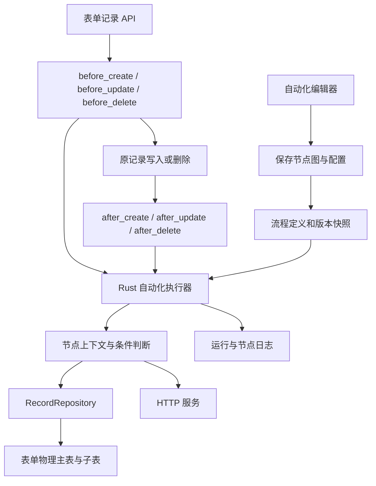
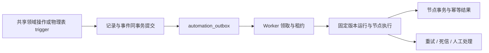

# 集成自动化完善方案

日期：2026-09-30  
状态：主体为设计与实施建议；保存与版本管理已调整并完成独立数据库回归验证  
依据：当前工作区代码静态审查，包括现有未提交改动；数据库验证仅覆盖保存与版本管理，节点执行尚未完成端到端验收。

## 1. 目标与实施原则

本方案优先保证以下业务结果：

1. 满足触发条件后，流程进入正确节点，按明确的连线和分支语义执行。
2. 查询返回真实数据库记录，记录标识、字段类型和结果数量在下游保持一致。
3. 条件基于本次运行的真实输入和已执行节点输出求值，缺失引用和不支持的表达式可被识别。
4. 新增、更新和删除作用于正确表单与记录，操作数量、写入值和最终数据库结果可核验。
5. 每个节点的成功、失败、跳过和未执行都有明确原因，运行成功不掩盖配置错误。
6. 失败后能够判断哪些副作用已提交，重试不会无提示地重复执行已完成的数据操作。

首先完善现有 Rust 执行器及其前后端协议，再逐步引入可靠事件投递和后台执行。无需为了修复节点正确性立即将整张自动化图编译为 PostgreSQL trigger。

合法的空查询和未命中条件并不一律视为失败。应通过节点策略明确该结果是允许的空结果、正常分支跳过，还是业务要求未满足。

## 2. 当前实现与数据链路

### 2.1 表单存储

表单由版本化 Schema、存储映射和物理数据组成。

| 层次 | 当前职责 | 主要代码 |
| --- | --- | --- |
| 设计器 | 修改字段和页面属性，保存完整 Schema | `web/app/(protected)/(main)/designer/[formUuid]/components/DesignerScreen.tsx` |
| Schema 管理 | 保存版本、更新当前版本与表单名称 | `api/src/modules/forms.rs`：`save_form_schema_definition` |
| 存储编译 | 计算表名、字段到列/JSONB/子表的映射，执行 DDL | `api/src/platform/form_storage.rs` |
| 记录仓储 | 按存储映射生成 SQL，重组统一记录数据 | `api/src/platform/records.rs` |

字段 ID 是逻辑键，不能直接当作 SQL 列名。文本、数字、日期等字段映射到派生物理列；多选、附件、富文本等进入主表 `extension_data JSONB`；子表单数组保留在主表 JSONB，并由数据库触发器投影到子表。纯展示节点不需要物理记录列。

删除普通字段时，当前映射不再包含它，但现有同步逻辑没有普通列的 `DROP COLUMN`。删除子表单可能删除对应子表。历史 Schema 不等于历史数据快照，类型变化或恢复 Schema 时不能默认旧值会自动迁移。

### 2.2 自动化定义、执行与日志



当前自动化主要实现于 `api/src/modules/automations.rs`：

- `execute_automation_flows_for_event` 筛选同应用、同触发表单、已启用的 `trigger` 流程。
- `execute_automation_flow` 创建运行、建立节点与连线索引，并从 `trigger-1` 开始执行。
- `execute_automation_children` 和 `execute_automation_node` 遍历图、调用节点处理器。
- `AutomationExecutionContext.outputs` 保存节点 ID 到 JSON 输出的映射。
- `api/src/platform/automation_runs.rs` 保存运行及节点输入、输出和状态。

自动化定义包含 `nodes_json`、`edges_json`；编排内容变更时建立版本快照，并同步节点、连线关系数据。当前执行器读取定义中的 JSON 图。

#### 保存与版本管理（2026-09-30 已调整）

- 状态仅保留启动（`enabled`）和停止（`paused`），新建默认停止。迁移将已有草稿和市场遗留 `disabled` 状态转换为停止；市场导入与归档也使用停止状态。
- 版本内容包括名称、说明、触发表单、触发事件、触发配置、节点及连线；比较后端规范化后的 JSON 内容，对象键顺序不影响相等判断，数组顺序仍计入变化。
- 启动/停止、操作人、更新时间和当前版本号不参与版本内容比较。仅修改状态或重复保存不会增加版本。
- 切换历史版本直接更新当前定义和 `current_version`，不新增快照，不改写历史版本，保留当前运行状态。
- 新版本号按历史最大版本号加一。例如 v5 切换到 v3 后，不修改内容保存仍为 v3；修改内容保存生成 v6。
- 新建时保存初始 v1 空图；编辑器首次加入触发节点并保存属于内容变化，可生成 v2。
- 保存和版本切换在数据库事务内锁定同一流程定义行，避免并发保存生成相同版本号。
- 该规则适用于保存与版本切换，不代表已完成运行重试固定版本等后续执行器改造。

当前普通自动化由请求链路同步等待执行。`before_*` 返回错误会阻止原记录操作；`after_*` 返回错误会记日志，但原记录操作仍可返回成功。这里的 before/after 是应用层调用时点，并非 PostgreSQL 事务触发器语义。

流程表单的 `process` 流程由 `api/src/modules/workflows.rs` 管理实例和人工任务；它共享数据/HTTP 节点处理器，但采用另一套节点推进逻辑。共享节点改动应覆盖普通自动化和流程表单两类调用方。

## 3. 已确认问题与待验证边界

以下“已确认”表示代码路径存在，不表示已对每种实际配置完成运行复现。

| 编号 | 问题 | 代码依据 | 对业务结果的影响 | 优先级 |
| --- | --- | --- | --- | --- |
| A01 | 公式映射直接返回公式字符串，没有计算 | `automations/expression.rs`：`build_record_data_from_rows` | 写入公式文本，数字列可能得到空值 | P0 |
| A02 | 新增节点输出缺少统一记录身份，查询节点才补 `__automationRecordUuid` | `automations.rs`：`execute_add_data_node`、`record_data_with_automation_identity` | 下游数据节点模式更新可能匹配零条 | P0 |
| A03 | 更新规则筛选忽略 `valueType=field`、`sourceFieldKey` | `automations/expression.rs`：`evaluate_record_rule` | 引用触发或查询字段的匹配规则不能按配置执行 | P0 |
| A04 | 节点处理器的 `await?` 在节点日志收尾之前返回 | `automations.rs`：`execute_automation_node` | 运行失败但节点日志仍为 running | P0 |
| A05 | 来源字段不存在时返回空集合，映射默认写 null，部分否定条件可能成立 | `resolve_source_field_values`、`evaluate_branch_rule` | 拼错引用或上游未执行可能被当作合法业务数据 | P0 |
| A06 | 查询返回字段配置未被处理器使用 | `normalize_automation_node_config`、`execute_get_one_node`、`execute_get_many_node` | 页面配置与实际输出不一致 | P1 |
| A07 | 数据节点查询/修改先全量读取再应用层筛选 | 查询、更新、删除节点处理器 | 大数据量时延迟和内存增长，影响运行完成 | P1 |
| A08 | 数据节点直接调用仓储，没有目标表单记录缓存失效 | 数据节点处理器及 `forms.rs` 的缓存函数 | 落库成功后部分读取入口可能显示旧数据 | P1 |
| A09 | 重试加载当前流程，未应用原运行版本快照 | `retry_automation_run_internal` | 旧输入和旧节点快照可能被新图解释 | P1 |
| A10 | 多节点写入无统一事务及节点幂等凭据 | 数据处理器、执行入口 | 部分节点成功后失败，重试可能重复新增或通知 | P1 |
| A11 | 多入边节点按深度遍历多次抵达，没有明确汇合执行策略 | `execute_automation_children`、路径集合的移除逻辑 | 允许的汇合图可能重复执行写入节点 | P1 |
| A12 | API 查询、数据节点写入与直接 SQL 写入的事件入口不同 | `forms.rs` 与仓储直接调用 | 自动化变更不会自然触发下一条自动化 | P1，取决于业务是否要求级联 |

还需要验证以下边界：

- 前端可保存的图结构是否包含多入边汇合，是否有禁止重复执行的设计约束。
- 节点引用是否仅允许引用上游可抵达节点，跨分支引用是否会进入有效配置。
- 数字、多选、日期等固定值是否被前后端保持为真实类型；当前映射规范化将 `rawValue` 读取为字符串，而数字物理列仅接受 JSON number。
- 字段删除、类型变化后，自动化保存和启用校验是否能明确阻止失效配置。
- 多个客户端同时更新同一记录时，仓储“读取后合并整条记录”的模式是否导致覆盖其他修改。
- 进程在运行中退出后，running 日志和已执行副作用如何恢复。

## 4. 统一定义节点执行契约

### 4.1 版本化运行上下文

建议为新执行契约引入独立 `contractVersion`。它描述执行协议版本，与流程定义 `flowVersion` 区分。

每次运行应固定以下内容：

| 属性 | 用途 |
| --- | --- |
| `runId`、`eventId` | 运行与触发事件身份 |
| `automationId`、`flowVersion`、`contractVersion` | 固定定义和解释规则 |
| `trigger` | 事件类型、触发表单、记录身份、before/after 数据、变化字段 |
| `operatorUserId`、`operatorName` | 稳定用户身份与审计名称 |
| `outputs` | 已完成节点的结构化输出 |
| `nodeStates` | 区分尚未执行、已完成、失败和分支跳过 |
| `causationId`、`depth` | 级联触发来源与深度，仅级联启用后使用 |

触发数据是事件发生时的快照，不随节点更新数据库自动刷新。需要最新值的节点必须重新查询，避免“触发字段”有时表示原值、有时表示最新值。

### 4.2 统一数据输出

新增、查询、更新、删除都应输出有身份的记录集合。单条查询同样保持集合结构，并提供显式取单条的引用方式。

```json
{
  "contractVersion": 2,
  "kind": "records",
  "formUuid": "FORM-EXAMPLE",
  "items": [
    {
      "recordUuid": "REC-EXAMPLE",
      "schemaVersion": 3,
      "data": { "amount": 100, "status": "approved" }
    }
  ],
  "matchedCount": 1,
  "affectedCount": 1,
  "empty": false
}
```

`matchedCount` 描述筛选结果；`affectedCount` 描述写入实际作用的记录数量。删除节点返回已删除记录的身份与操作前数据，避免后续再查询不到记录导致身份丢失。

旧契约中的 `__automationRecordUuid` 应通过明确的兼容适配器转换，不再分散在个别节点处理器中。新旧版本输出不可混用而不做转换。

### 4.3 引用与集合取值

引用必须能够识别：来源节点不存在、来源节点未执行、来源分支跳过、查询合法为空、字段不存在、字段存在且值为 null。这些情况不能都压缩成空字符串或 null。

集合来源的映射必须明确指定一种策略：

- `single`：必须恰好一条，否则失败。
- `first`：按确定的排序取第一条。
- `all`：保留全部结果，用于集合字段或批量处理。
- `each`：逐条处理，每条拥有独立的映射上下文。

禁止默认使用 `.next()` 丢弃多条结果。对 `first` 查询必须指定稳定排序，默认可采用 `created_at DESC, record_uuid DESC`。

## 5. 节点流转与条件语义

### 5.1 图校验

保存和启用时校验入口唯一、节点类型合法、连线有效、无环、节点可达、引用依赖有效。现有后端校验已覆盖部分入口、失效连线和循环问题，应补齐可达性、分支 handle 与引用依赖。

第一阶段建议禁止多入边写入节点和未经定义的汇合图，给出具体配置错误。后续需要汇合时再实现显式 join 节点：只有已选路径要求的前置节点均到达后执行一次，并记录到达边。

流程图展示顺序不能隐式决定业务优先级。条件分支使用配置优先级，普通多出口必须定义为按序全部执行或仅允许单出口。

### 5.2 条件选择

一个条件节点按优先级选择第一个匹配的分支。未命中时支持显式默认分支，或配置 `noMatchPolicy=skip/fail`。

跳过的分支及其后续节点记录 `skipped` 和原因，例如 `branch_not_selected`。节点未抵达不能仅从“没有日志”推断。

条件求值遵循类型：数字比较数字、日期比较日期、集合按包含关系判断；不得统一序列化为字符串后承担所有比较。

引用失效时应返回配置错误；查询合法为空时按 empty 策略处理。特别是 `neq`、`notInAny`，不能让错误引用自动满足否定条件。

### 5.3 表达式与公式

现有表达式实现主要支持 `==`、`!=` 与 `&&`，未提供完整公式计算。新实现应选择可维护的表达式解析器，约定支持的运算与函数，不执行任意 SQL、JavaScript 或系统命令。

最低支持范围：类型化字面量、字段引用、比较、逻辑组合、括号、数值运算及少量必要字符串/日期函数。具体函数列表由 UI 和后端共用版本化定义。

公式返回真实 JSON 类型；解析错误、缺失引用、除零和类型不兼容应报节点错误。不支持的语法不能原样写入目标字段。

## 6. 数据节点完善

### 6.1 查询节点

查询配置应包括目标表单、结构化筛选、字段选择、排序、数量上限和 empty 策略。

- 筛选下推到参数化 SQL，使用逻辑字段到物理列/JSONB 路径的映射。
- SQL 标识符只来自受控存储映射，参数化值不作为列名拼接。
- `get-one` 使用 `LIMIT 1`；`get-many` 有明确分页或最大返回数。
- 实现 `fieldSelection`，同时保留记录身份元数据。
- 数据节点来源模式也应用筛选与字段选择，避免与表单来源模式行为不一致。
- 没有匹配时明确返回合法空集合；必需命中的节点可配置失败。

### 6.2 新增节点

新增前根据目标表单当前 Schema 校验字段 ID、类型、必填项和可写性。单条和批量新增都返回记录身份、实际写入值和影响数量。

多条模式逐项绑定 `each` 上下文。必须实现或禁止 `multipleFormula` 等未执行的配置，保存成功应意味着运行器能够解释该配置。

新增到流程表单时初始化系统状态，但不默认自动发起审批；是否发起由独立显式动作控制。

### 6.3 更新节点

统一结构化规则与来源字段解析。数据节点模式使用记录身份集合直接定位，先验证来源记录表单与目标表单一致。

更新采用字段 patch，避免用陈旧整条记录覆盖并发更新。可采用行锁或记录版本检查；冲突产生明确错误，不静默覆盖。

支持 `requireMatch`、`minAffectedRows`、`maxAffectedRows`。例如更新订单状态要求至少一条且最多一条；匹配零条或超出上限应失败。

业务实际没有变化与确实修改要分别计数或明确约定，避免“匹配一条”被误读为“一条值已改变”。

### 6.4 删除节点

当前自动化删除调用 `delete_many`，与表单 API 的回收站/软删除路径不同。需要在产品中明确删除策略，并统一实现。

建议默认业务删除走软删除或回收站；永久删除是显式配置，需有匹配数量限制。空筛选导致全表匹配时要求显式 `allowAllRecords`。

删除的影响数量必须使用数据库返回值，并核验记录身份；操作后的缓存与关联数据同步不能遗漏。

### 6.5 共享领域写入入口

将身份初始化、系统字段保护、类型校验、缓存失效、审计、回收站和可选事件投递集中到共享领域操作层。HTTP handler 和自动化节点均调用该层，`RecordRepository` 继续承担存储访问。

自动化配置字段删除后必须在启用与运行时检查引用。旧物理列残留不能被解释为字段仍有效；否则写入可能进入 JSONB，实际页面已没有该字段。

## 7. 成功、失败与数据一致性

### 7.1 状态契约

| 对象 | 建议状态 |
| --- | --- |
| 运行 | `pending`、`running`、`success`、`failed`、`partial_failed`、`cancelled` |
| 节点 | `pending`、`running`、`success`、`empty`、`skipped`、`failed` |

定义一个运行何时成功：所有选中路径的必需节点按约定完成；允许的 empty/skipped 已按策略记录；没有配置错误、未收尾节点或未核验写入。

`partial_failed` 表示运行失败且已有不可撤销或已提交副作用，不表示下游继续执行。失败默认停止所依赖的后续节点，只有配置了错误分支才进入错误处理路径。

### 7.2 节点异常收尾

节点处理器返回 `Result<NodeOutput, NodeError>`，外层统一收集结果再写日志。避免在日志收尾之前通过 `?` 退出。

日志至少记录：节点身份、实际分支、输入引用、查询数量、影响数量、记录身份、提交状态、错误码、可重试性和耗时。业务错误与日志落库失败都需要可观察。

### 7.3 事务策略

阶段一建议采用每个数据节点事务：该节点的数据写入、幂等凭据和结果日志共同提交。多节点运行允许已提交节点保留结果，但要明确 partial 状态。

纯数据库短流程可后续支持整段事务，但设置节点数、处理行数和时间限制。HTTP 节点不应占用长事务等待外部服务。

`before_*` 如承担业务校验，应限制允许的副作用或明确事务边界。当前“before 节点写入成功、后续失败导致原记录未保存”需要作为专门验收场景。

### 7.4 缓存与页面

每个写入节点提交后失效目标表单及其依赖明细的记录缓存。前端刷新目标表单查询，不能仅刷新触发表单。

数据库写入成功但读取旧缓存属于链路未完整验收。验收应同时核验 SQL 结果、查询 API 和页面数据。

## 8. 重试、恢复与事件触发

### 8.1 固定版本重试

重试使用原运行 `flowVersion` 的节点图、条件、映射和契约版本。希望使用最新配置时提供明确“以新版本重新运行”动作，创建新运行并标明与旧运行的关系。

单节点重试从原节点输入快照恢复；若该快照不包含必须的上游身份或类型，拒绝重试并说明原因。

### 8.2 幂等与崩溃恢复

节点幂等键建议包含 `eventId + flowVersion + nodeId + itemIndex`。手动重试同一事件应继承逻辑执行身份，同时拥有新的 attempt。

数据写入与幂等成功标记在同一事务提交，避免写入后进程退出、重试又新增一次。HTTP 使用目标服务支持的幂等键；不支持时记录外部结果不确定状态，避免宣称能够保证只执行一次。

多入边汇合和重复事件必须使用数据库唯一约束与节点状态校验防重复，单纯进程内 HashSet 无法覆盖多 Worker 或崩溃重启。

### 8.3 是否级联触发

明确自动化写入目标表是否再次触发自动化。第一阶段可保留当前不级联行为，但 UI 和文档应说明；后续启用级联时加入事件来源、最大深度、重复访问策略和循环诊断。

不能直接给所有写入追加事件而不做防护，否则 A 更新 B、B 更新 A 会无限触发。

### 8.4 后续可靠事件投递

正确性修复后再引入 PostgreSQL outbox 与 Rust Worker：



触发来源在实施时统一选择，防止应用层和物理 trigger 对一次写入各投递一次。若采用物理 trigger，需要定义 OLD/NEW 到逻辑字段数据的转换、软删除事件、内部元数据更新与真实业务变更的区别，并在 Schema/映射变化时同步维护。

Worker 可采用 `FOR UPDATE SKIP LOCKED` 领取事件，配合租约、心跳和过期恢复。事件表包含稳定事件 ID、记录身份、操作类型、载荷快照、来源和状态；领取阶段与节点执行分开，不持有事件行锁等待 HTTP。

Worker 只消费已提交事件，因此适合 after 事件。before 校验仍在同步写入路径中完成，不能把 before 行为无提示改成提交后执行。

## 9. 前端配置和运行诊断

配置页面与运行器应共享能力清单或版本化契约：已开放的每种选项必须可执行。暂未实现选项明确禁用，不允许保存后静默忽略。

运行详情至少展示：选中分支、每节点状态、查询/影响数量、目标表单、记录链接、类型化输入输出、失败原因和已提交副作用。对于包含敏感字段的输入输出，按访问权限与日志策略控制展示。

支持对查询和条件进行受控预览：选择样例输入，展示引用解析与预期结果；数据写入预览展示目标及数量，不产生写入。预览必须标明它不能代替真实提交时的并发校验。

运行页面的成功标识由后端状态决定。HTTP 响应状态码也应有可配置的成功范围；当前处理器返回响应 status/body，4xx/5xx 不会自然转换为节点失败。

## 10. 分阶段实施清单

### 阶段一：节点正确性与可信日志

- [ ] 修复节点异常日志收尾。
- [ ] 定义版本化统一输出和记录身份；为旧流程提供适配。
- [ ] 修复更新规则来源字段求值。
- [ ] 实现类型化固定值及公式求值；不支持的配置阻止启用。
- [ ] 区分错误引用、null、合法空查询、跳过分支。
- [ ] 增加命中数量策略及数据写入实际影响数量。
- [ ] 校验可达性、引用依赖、分支 handle；先约束未定义的汇合图。
- [ ] 实现返回字段配置与 HTTP 成功状态策略。
- [ ] 完成真实 PostgreSQL 节点链路验收。

完成条件：正常路径输出与数据库预期一致；错误配置不被记录为成功；失败节点能够准确定位。

### 阶段二：写入一致性、查询效率与重试

- [ ] 建立共享领域写入入口，统一系统字段、删除和缓存行为。
- [ ] 查询与匹配下推 SQL，限定返回和操作数量。
- [ ] 实现 patch 更新与并发冲突策略。
- [ ] 重试固定原流程版本。
- [ ] 节点事务、幂等结果与 partial 状态落地。
- [ ] 完成同事件重试、并发写入和中途失败验收。

完成条件：重试不会重复已核验的数据副作用；并发写入不无提示覆盖；落库与 API 页面读取一致。

### 阶段三：后台执行与可靠事件

- [ ] 选择统一事件捕获来源，并设计 eventId 与载荷版本。
- [ ] 建立 outbox、Worker 租约、恢复与死信机制。
- [ ] 明确级联触发策略与循环保护。
- [ ] 校验进程崩溃恢复及多 Worker 竞争。
- [ ] 完成真实表单写入到节点结果的端到端验收。

完成条件：已提交事件不因进程中断丢失；可恢复运行有明确恢复结果；无法自动恢复的事件进入可处理状态。

## 11. 验收矩阵

测试使用独立测试数据库和临时应用/表单，不修改现有业务数据。通过实际 Schema 创建物理表，使用唯一运行标记清理测试资源。

| 场景 | 操作 | 必须验证 |
| --- | --- | --- |
| 单链路 | 触发 → 查询一条 → 条件 → 新增 | 节点顺序、匹配分支、字段类型、落库值、记录身份 |
| 新增后更新 | 新增 → 数据节点模式更新 | 更新刚新增记录，影响数为 1，没有误更新其他记录 |
| 来源字段匹配 | 触发订单号 → 更新规则引用订单号 | 仅对应记录修改，expected 来自真实触发值 |
| 公式写入 | 数值加法及字段引用公式 | 数字列值正确，错误语法失败且没有写入公式文本 |
| 多条查询 | 查询多条 → each 批量新增/更新 | 不遗漏、不默认取第一条，每条来源与目标对应 |
| 合法空结果 | 查询零条，允许为空 | empty 及下游策略正确，运行详情说明原因 |
| 必须命中 | 查询/更新零条，requireMatch=true | 节点失败，后续写入不执行 |
| 条件分支 | 两分支同时匹配、无分支匹配 | 按优先级选择，默认分支或 noMatch 策略生效 |
| 失效引用 | 删除来源字段或引用跳过节点 | 明确错误或合法 skip，不能误走 neq 分支 |
| 返回字段 | 查询指定字段 | 输出按选择裁剪，记录身份保留 |
| 节点异常 | 数据校验错误、HTTP 超时 | run/node 均收尾，错误定位准确 |
| 部分失败 | 第一节点写入，第二节点失败 | 已提交结果与 partial 状态一致，重试不重复第一节点 |
| 版本重试 | 运行失败后修改流程再重试 | 默认按原版本执行，新版本重跑有独立标识 |
| 缓存刷新 | 自动化更新另一个表单 | SQL、查询 API、缓存读取入口与页面结果一致 |
| 删除 | 删除一条、空筛选、超数量上限 | 删除模式正确，上限生效，回收站/身份信息符合策略 |
| 并发 | 两运行修改同一记录不同字段 | 无丢失更新，冲突可见 |
| 汇合图 | 两入边抵达同一写入节点 | 第一阶段拒绝配置，支持 join 后只执行一次 |
| 崩溃恢复 | 写入事务提交后终止 Worker | 同事件恢复不重复写入，状态可解释 |
| 级联 | A 更新 B，B 更新 A | 按策略停止或拒绝，不无限运行 |

每个写入场景同时检查：运行/节点日志、数据库目标记录、下游输入、最终 API 返回。测试断言实际业务值和数量，不只断言 HTTP 200 或运行 success。

## 12. 实施涉及文件与完成记录

主要后端位置：

- `api/src/modules/automations.rs`：触发选择、节点处理、图执行、条件与重试。
- `api/src/modules/automations/expression.rs`：引用、映射、表达式、规则求值。
- `api/src/modules/automations/graph.rs`：保存规范化与图校验。
- `api/src/modules/automations/runtime.rs`：运行上下文。
- `api/src/platform/automation_runs.rs`：运行及节点日志持久化。
- `api/src/platform/records.rs`：记录存储、查询、patch 与并发控制。
- `api/src/platform/form_storage.rs`：字段存储映射和物理表同步。
- `api/src/modules/forms.rs`：表单事件、Schema、缓存和共享领域写入入口。
- `api/src/modules/workflows.rs`：共享节点在流程表单中的调用与状态兼容。
- `api/src/infrastructure/entities/`、`api/src/infrastructure/migrator.rs`：新增状态、执行凭据、outbox 等迁移。
- `api/src/openapi.rs`、`api/openapi/openapi.json`：契约变化后的 API 定义与生成。

主要前端位置：

- `web/app/(protected)/(main)/[appId]/automations/[automationId]/automation-editor-model.ts`。
- 同目录 `components/AutomationFieldMappingEditor.tsx`、`AutomationDataNodeConfig.tsx`、`AutomationConditionRuleEditor.tsx`、`PageClient.tsx`。
- `web/features/automation-editor/` 和 `web/app/components/workflow-editor/` 的图命令与校验。
- `web/app/lib/api-client/`：按 OpenAPI 重新生成，避免直接手改生成文件。

实施过程中逐项更新阶段清单和以下记录；文档编写完成不代表功能修复完成。

| 日期 | 阶段/问题编号 | 实施变更 | 验证命令或场景 | 结果/剩余问题 |
| --- | --- | --- | --- | --- |
| 2026-09-30 | 方案建立 | 完成当前链路审查与完善设计 | 静态代码核对 | 尚未实施，尚未完成数据库验收 |
